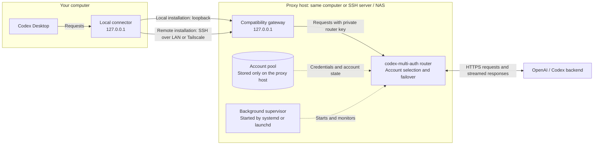

# Codex Multi Auth Setup

A guided terminal installer for [codex-multi-auth](https://github.com/ndycode/codex-multi-auth). Run the account proxy on your own computer or an SSH server/NAS, connect Codex Desktop, and keep the proxy and an optional managed Codex CLI updated.

The wizard uses [`@clack/prompts`](https://github.com/bombshell-dev/clack). Prompts are in German; upstream account screens use the proxy's own interface. This is an independent setup helper, not an OpenAI product or a fork of the account manager.

## Start

Requires Node.js **22.19 or newer**, npm, and macOS or Linux. For a remote installation, you also need an existing SSH account with key/agent authentication. Windows users can run the server-side tools in WSL2; native Windows Desktop integration is not implemented.

```sh
git clone https://github.com/sk2andy/codex-multi-auth-setup.git
cd codex-multi-auth-setup
npm ci
npm start
```

The repository is public; cloning does not require a GitHub account. Nothing is published to npm by this project.

Setup automatically installs `codex-ma-setup` into `~/.local/bin`, using its own
installed manager and Node runtime. All subcommands then work from any directory.
If needed, setup adds that directory to your interactive zsh, bash, or fish
configuration; open a new terminal afterward. Other shells show a manual PATH
instruction. Existing launcher and shell files are backed up before changes.

The launcher remembers the client profile used during setup. Use
`codex-ma-setup --client-root /absolute/path stats` to choose another profile.
Before setup, run commands with `npm start -- stats` (or another command) from the
checkout. Background services and the installed terminal command use their own
copy and do not depend on the checkout remaining open.

The wizard asks for:

1. **Local or SSH server**, with a dedicated installation folder such as a directory on NAS storage.
2. **SSH hostname, IP, or existing alias**, optional identity file and fallback destination. For example, use a LAN hostname first and a Tailscale address when away.
3. **Optional Tailscale installation.** Authentication stays with Tailscale's own app/login flow.
4. **Account selection:** sequential or hybrid. Upstream currently has no pure round-robin mode; hybrid means health/quota-aware selection, not round robin.
5. **Optional automatic updates**, check interval, and proxy release age. Default: at least **48 hours** old; configurable from 0 to 8760 hours. The same rule applies to the first installation.
6. **Optional managed Codex CLI.** Its stable releases have no additional age delay. Existing system/npm/Homebrew installations are left in place. A backed-up `~/.local/bin/codex` link is an explicit additional choice.
7. **Account onboarding**, using the official device-login command. Add one or multiple accounts locally or over SSH; no callback-port forwarding required.
8. **Desktop configuration.** After a successful connection test, the wizard backs up and changes the local `openai_base_url` while preserving unrelated TOML and comments.

When prompted at the end, **fully quit Codex Desktop and reopen it**. Then send a small request. Changing only the server's hostname/IP later normally needs no Desktop restart because the local endpoint stays the same.

## How it works

Codex Desktop sends requests to a fixed address on your own computer. A small background connector forwards them to the proxy host: directly for a local installation, or through an encrypted SSH tunnel for a server/NAS installation. The SSH connection can use your LAN address or the configured Tailscale fallback.



The gateway adds the private router key and forwards streamed responses back along the same path. The upstream router owns account selection, token refresh, and failover between eligible accounts. Sequential mode follows account order; hybrid mode considers account health and quota. Available models and account eligibility still determine which account can serve a request.

The background services keep running after the setup terminal closes, subject to the platform's login requirements described below. Account management and updates use a maintenance lock: existing requests drain, the router pauses, then it resumes after the operation. This keeps two processes from refreshing the same account tokens simultaneously. The optional update scheduler checks releases separately and applies the configured release-age delay.

### Proxy-specific settings

The underlying proxy is **[ndycode/codex-multi-auth](https://github.com/ndycode/codex-multi-auth)**. For settings beyond this installer's menu, consult its [configuration guide](https://github.com/ndycode/codex-multi-auth/blob/main/docs/configuration.md) and [command reference](https://github.com/ndycode/codex-multi-auth/blob/main/docs/reference/commands.md).

Run upstream commands through this helper so they use the correct account pool and target, whether local or over SSH:

```sh
codex-ma-setup proxy -- --help
codex-ma-setup proxy -- config explain
codex-ma-setup proxy -- <upstream-command> <arguments>
```

Use `codex-ma-setup configure` for settings owned by this installer, such as SSH addresses, account strategy, and update schedules. The helper sets the router's account directory and strategy when it starts; upstream defaults may therefore be overridden by these managed settings. Files inside `current-proxy` belong to an installed release, so source edits there do not carry over to the next update.

## Daily commands

| Command                                 | Purpose / upstream command                                                        |
| --------------------------------------- | --------------------------------------------------------------------------------- |
| `codex-ma-setup`                        | Guided menu                                                                       |
| `codex-ma-setup install`                | New local/SSH installation                                                        |
| `codex-ma-setup connect`                | Connect another computer to an existing SSH installation                          |
| `codex-ma-setup configure`              | Change SSH address/fallback/key, strategy, Tailscale, updates, or Desktop binding |
| `codex-ma-setup accounts add`           | `codex-multi-auth login --device-auth --preserve-selection`                       |
| `codex-ma-setup accounts list`          | `codex-multi-auth list`                                                           |
| `codex-ma-setup stats`                  | `codex-multi-auth status`                                                         |
| `codex-ma-setup accounts usage`         | `codex-multi-auth usage`                                                          |
| `codex-ma-setup accounts remove`        | Opens `codex-multi-auth login`; select account, then Delete (`D`)                 |
| `codex-ma-setup proxy -- limits --json` | Passes arguments unchanged to the official proxy CLI                              |
| `codex-ma-setup proxy -- --help`        | Official proxy command help                                                       |
| `codex-ma-setup codex -- --version`     | Run the separately managed Codex CLI on the selected target                       |
| `codex-ma-setup doctor`                 | Runtime, catalog, service, installation versions, and client connection           |
| `codex-ma-setup resume`                 | Continue interrupted onboarding without resetting accounts                        |
| `codex-ma-setup recover`                | Explicit recovery of abandoned maintenance; never restores old OAuth tokens       |

Account helpers always use the installed upstream tool and its actual account store. There is no second OAuth implementation, made-up `remove` command, or copied account-selection algorithm. The official interactive account manager owns deletion and confirmation.

Account management pauses the router for the duration of the command after current requests drain. A browser login can therefore keep the proxy paused until that login completes or is cancelled. This prevents the router and account tool from refreshing the same token concurrently. If a request cannot drain in time, the operation stops rather than interrupting it. Try again when the proxy is quiet.

See the [upstream command reference](https://github.com/ndycode/codex-multi-auth/blob/main/docs/reference/commands.md) for available arguments. Index conventions may differ between JSON and interactive commands; this helper does not translate indices.

## Automatic updates

```sh
codex-ma-setup updates enable
codex-ma-setup updates disable
codex-ma-setup updates configure
codex-ma-setup updates check
codex-ma-setup updates run
codex-ma-setup updates status
```

`configure` can install the schedule after initial setup, switch systemd/cron on Linux, and change the release delay. `run` is an explicit manual check/apply even when scheduling is disabled; it **still respects the configured release age**. `disable` removes only this installation's automatic schedule and leaves the proxy running.

Updates:

- select stable releases only; do not downgrade when a release tag moves backward;
- check package digests, archive contents, platform, and reported version;
- stage each release separately and install proxy dependencies with lifecycle scripts disabled;
- block new gateway requests while draining existing work;
- back up configurations and account state before changing selected programs;
- atomically switch the selected package and check the real model catalog;
- restore the previous **program** if verification fails, keeping current OAuth tokens;
- retain a journal for interrupted updates and delay automatic retries of the same failed version pair by 24 hours.

Routine verification does not send inference requests. An optional `updates.smokeModel` in the server's private `config.json` enables an actual inference check; this may consume account usage. Scheduled failures and deferred runs appear in `maintenance-state/status.json` and the service logs. There is no external notification integration.

The managed CLI is a complete official package, including its code-mode host and resources. Updating it does **not** replace the CLI bundled inside Codex Desktop or automatically take over an existing native app-server daemon. `doctor` reports those versions separately. Use the Desktop application's own restart/update controls when its background process is older.

## Platform and network details

| Component                      | macOS                              | Linux                                                      |
| ------------------------------ | ---------------------------------- | ---------------------------------------------------------- |
| Runtime and local connector    | User LaunchAgents; login required  | systemd user service, or explicit system service with sudo |
| Automatic updates              | LaunchAgent interval               | systemd timer or optional marked cron block                |
| Server without an active login | Not provided by a user LaunchAgent | Choose system service; alternatively enable user lingering |
| CPU architectures              | Intel / Apple Silicon              | x64 / ARM64                                                |

The SSH target needs `tar` and standard shell utilities. If an adequate Node runtime is absent, setup installs a verified Node 24 LTS package into its own directory. Installing Tailscale on Linux uses the [official installer](https://tailscale.com/install.sh) after backing up existing relevant configuration; macOS installation uses Homebrew's Tailscale cask. System package installation may request sudo. Tailscale itself is optional: ordinary LAN SSH works without it.

All proxy listeners bind to **127.0.0.1**. The connector uses strict SSH host-key verification and forwards only to the selected loopback gateway. A LAN `.local` name generally does not resolve while away; configure a Tailscale DNS/IP fallback rather than assuming multicast DNS travels through the VPN. Both destinations must identify the same installation.

Account and update commands also select a reachable SSH address before starting work. Once a command starts, a connection failure is reported without replaying that command on the other address; this prevents duplicated changes after an uncertain result.

Your SSH server must permit local forwarding to the gateway port shown by setup. On managed NAS appliances, change this through the appliance's supported configuration mechanism; this project does not overwrite SSH server policy. A restrictive server typically needs the equivalent of:

```text
Match User YOUR_SSH_USER
    AllowTcpForwarding local
    PermitOpen 127.0.0.1:GATEWAY_PORT
Match all
```

Use the actual port from your installation. Check SSH configuration before reloading it. A server may also impose `authorized_keys` restrictions; the installer cannot override those from a client.

Tailscale fallback preserves the encrypted SSH connection. It does not expose an unauthenticated HTTP proxy to the LAN or Tailnet. Browser-origin requests and non-loopback Host headers are rejected by the compatibility gateway.

## Backups and files

### Forwarder configuration

The shared connector is `src/forwarder.mjs`. Managed installations start it with
`--root CLIENT_ROOT`, reading `CLIENT_ROOT/client.json`. That file controls
`mode` (`local` or `ssh`), `ports.client` (Desktop listener), `ports.gateway`
(gateway on the proxy host), `ports.tunnel` (local SSH tunnel), and `ssh` options
(`host`, optional `fallbackHost`, `port`, `identityFile`, `hostKeyAlias`). SSH
destinations include the username, for example `user@server.example`.

For a standalone connector to an existing gateway, copy
[`examples/forwarder.json`](examples/forwarder.json) to a private location such as
`~/.config/codex-multi-auth-setup/forwarder.json`, edit its values, and start:

```bash
node src/forwarder.mjs --config /absolute/path/to/forwarder.json
```

Use this same command in your background service. A standalone file is separate
from the installer's `client.json`; it does not register a managed server or enable
installer account/update commands. Restart the connector after changing the file.
When changing `ports.client`, also update Desktop's `openai_base_url` to
`http://127.0.0.1:CLIENT_PORT` and fully restart Desktop. In `local` mode the
connector reaches the local loopback gateway directly; `ssh` options and
`ports.tunnel` are not required.

The default `healthCheck: "setup"` requires this installer's owned health response
and verifies `installationId` when present. For an existing legacy compatibility
gateway only, explicitly select `healthCheck: "legacy"`: this checks for HTTP 404
at `/__websocket_auth_check__`. This checks reachability without proving installation
identity, so it cannot be combined with `installationId`. There is no automatic
fallback to the legacy check. LAN and Tailscale fallback routes must still lead to
the same trusted proxy host.

Default client metadata: `~/.config/codex-multi-auth-setup/client.json`. Default server directory: `~/.local/share/codex-multi-auth-setup`. You can select a NAS storage directory instead. Use `--client-root /absolute/path` before `--` to manage a separate client profile.

| Server path                    | Contents                                                                |
| ------------------------------ | ----------------------------------------------------------------------- |
| `config.json`                  | Private setup settings and gateway secret                               |
| `data/multi-auth/`             | Upstream account pool                                                   |
| `data/codex/`                  | Isolated Codex state used by upstream management commands               |
| `current-proxy`, `current-cli` | Selected package links                                                  |
| `releases/`                    | Verified, retained program versions                                     |
| `manager/`                     | Installed copy of this helper; independent of the Git checkout          |
| `backups/`                     | Timestamped installation/config/account/service snapshots and manifests |
| `maintenance-state/`           | Update status and recovery journal                                      |
| `logs/`                        | Runtime and update logs on LaunchAgent/cron deployments                 |

Every installation and configuration-changing path makes a backup first. Service changes preserve the prior unit/plist files and complete crontab; unrelated cron jobs remain intact. A failed service activation attempts to restore the previous service configuration and state. Files and backup directories containing credentials are private to the user.

Backups and old releases are retained; no automatic pruning is performed. Never blindly restore an old account file: OAuth refresh tokens may already have rotated. Normal rollback/recovery changes selected programs, not tokens.

An interrupted wizard stores a checkpoint. Run `resume`, finish account onboarding, then complete service setup. If `doctor` reports abandoned maintenance, `recover` requires confirmation, refuses a live owner, and uses the recorded recovery path. Do not delete locks while an update or login is running.

## Development

```sh
npm ci
npm run check
npm run lint
npm run format:check
npm test
npm pack --dry-run
```

Tests use temporary homes, fake upstream processes, real loopback HTTP/streaming, and controlled fake SSH subprocesses. No test reads real OAuth pools or changes installed services. CI runs on Linux and macOS with Node 22.19 and 24. Live package staging has additionally been checked against official proxy and CLI releases; live account login still requires the user's browser.

## Scope

This helper installs and manages its own deployment. It does not automatically migrate an arbitrary existing multi-auth installation, alter NAS-wide SSH policy, update Node/nginx/OS packages on a schedule, publish credentials, or share account pools through GitHub. Use fresh device sign-ins for the new pool.

MIT licensed. Upstream `codex-multi-auth` remains separately maintained under its own license.
